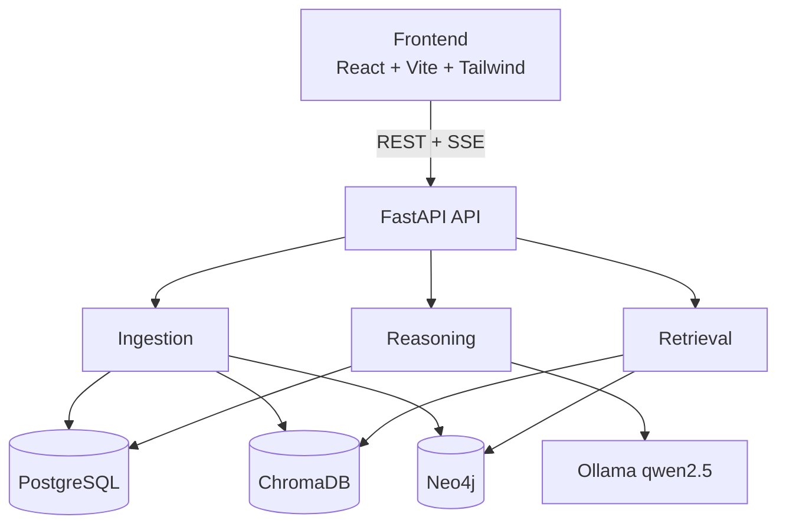
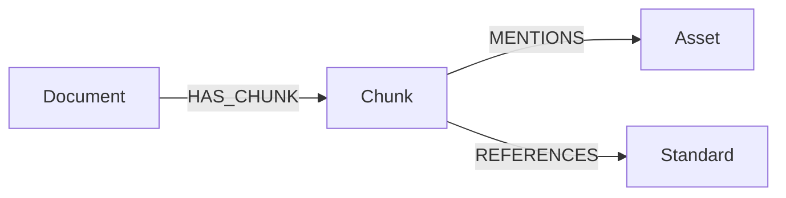
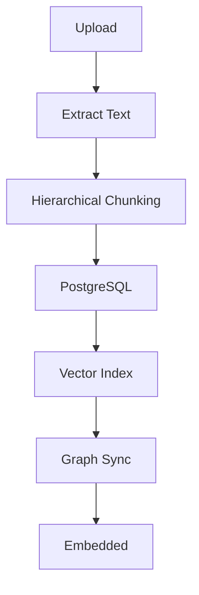

# IndusBrain

**The Operating System for Industrial Knowledge**

An AI-powered Industrial Knowledge Intelligence platform that ingests heterogeneous industrial
documents, builds a queryable knowledge graph, and answers engineering questions with traceable
evidence — never with guesses.

Built for **ET AI Hackathon 2026 — Problem Statement 8: *AI for Industrial Knowledge Intelligence:
Unified Asset & Operations Brain***.

---

## Table of Contents

- [Overview](#overview)
- [Problem Statement](#problem-statement)
- [Solution Overview](#solution-overview)
- [Features](#features)
- [System Architecture](#system-architecture)
- [Multi-Agent Workflow](#multi-agent-workflow)
- [Knowledge Graph Architecture](#knowledge-graph-architecture)
- [Hybrid GraphRAG Pipeline](#hybrid-graphrag-pipeline)
- [Document Ingestion Pipeline](#document-ingestion-pipeline)
- [OCR Pipeline](#ocr-pipeline)
- [Design Principle: Honest AI](#design-principle-honest-ai)
- [Technologies Used](#technologies-used)
- [Folder Structure](#folder-structure)
- [Installation Guide](#installation-guide)
- [Contributors](#contributors)
- [License](#license)

---

## Overview

Industrial plants run on documents: OEM manuals, standard operating procedures, maintenance logs,
inspection reports, safety standards and engineering change notices. That knowledge is real, but it is
scattered across systems that do not talk to each other — and the engineers who hold the rest of it in
their heads are retiring.

IndusBrain turns that fragmented corpus into a single queryable brain. It reads the documents,
recognises the equipment inside them, links everything into a knowledge graph, and lets an engineer
ask a question in plain English — returning an answer where every claim is traceable to the passage it
came from.

**The defining constraint of this project: the system must never invent an answer.** In a plant, a
confident wrong number about a pressure limit is more dangerous than no answer at all. IndusBrain
refuses when it lacks evidence, and it shows its work when it has evidence.

---

## Problem Statement

> *ET AI Hackathon 2026 — Problem Statement 8*
> **AI for Industrial Knowledge Intelligence: Unified Asset & Operations Brain**
>
> Build an AI-powered Industrial Knowledge Intelligence platform that ingests heterogeneous
> documents — engineering drawings, maintenance records, safety procedures, inspection reports,
> operating instructions, project files — across structured and unstructured formats, and makes their
> collective intelligence queryable, actionable, and continuously updated at the point of need, across
> any device or function.

**Context from the brief:**

- Professionals in asset-intensive industries spend an average of **35% of working hours** searching
  for information (McKinsey, 2024).
- The average large Indian plant operates across **7–12 disconnected document systems**
  (NASSCOM-EY).
- Fragmentation contributes to **18–22% of unplanned downtime** in Indian heavy industry
  (BIS Research).
- An estimated **25% of India's experienced industrial engineers** will retire within the next decade,
  taking undocumented operational knowledge with them.

---

## Solution Overview

IndusBrain addresses the problem in four layers:

| Layer | What it does |
|---|---|
| **Ingestion** | Extracts text from PDFs with a three-stage cascade, splits it into parent/child passages, and indexes it |
| **Knowledge** | Recognises equipment tags and builds a Neo4j graph linking assets to the passages that mention them |
| **Retrieval** | Searches the vector index and the knowledge graph in parallel, then fuses and re-ranks the results |
| **Reasoning** | Routes the question to a specialist agent, which generates a grounded answer with citations |

The result is not a chatbot bolted onto a search box. It is an auditable reasoning pipeline where every
step is recorded and replayable.

---

## Features

### Core intelligence

| Feature | Description |
|---|---|
| **Hybrid GraphRAG** | Vector similarity and knowledge-graph traversal run in parallel; passages found by both are marked *corroborated* — the strongest evidence class |
| **Multi-Agent Workflow** | A supervisor classifies intent and dispatches to one of four genuinely differentiated specialists |
| **Knowledge Graph** | Assets, documents, passages and standards linked as a traversable graph |
| **Conflict Detection** | Finds contradictions where two documents state different values for the same parameter on the same asset |
| **Organizational Memory** | Surfaces past maintenance events quoted verbatim, with real dates and work-order numbers |
| **Decision Replay** | A node-by-node execution trace written by the pipeline as it runs |
| **AI Confidence** | An evidence-strength score computed from measured retrieval quality, capped at 95% |

### Workspace

| Feature | Description |
|---|---|
| **Expert Knowledge Copilot** | Streaming chat with live pipeline stages, citations and an evidence panel |
| **Knowledge Explorer** | Every discovered asset with per-category documentation coverage |
| **Analytics** | Knowledge health score with a published formula — no black-box metrics |
| **Impact Assessment** | Evidence-based evaluation of a proposed operational decision |
| **Document Viewer** | In-app PDF rendering plus the extracted passages exactly as indexed |
| **Conversation History** | Titled, searchable threads with full evidence preserved across reloads |
| **Dynamic Suggestions** | Starter questions generated from the live corpus, never hardcoded |
| **Role-Based Access** | Manager and Engineer roles, enforced server-side |

---

## System Architecture



---

## Multi-Agent Workflow

Implemented as a **LangGraph state machine** with six nodes.

```
                        ┌───────────────┐
                        │  SUPERVISOR   │   regex intent classification
                        └───────┬───────┘   (records real keyword counts)
                                │
        ┌───────────────┬───────┴────────┬────────────────┐
        ▼               ▼                ▼                ▼
┌───────────────┐ ┌─────────────┐ ┌──────────────┐ ┌──────────────┐
│  KNOWLEDGE    │ │ RELIABILITY │ │  COMPLIANCE  │ │  CONFLICT    │
│  specs &      │ │ maintenance │ │  safety &    │ │  cross-doc   │
│  manuals      │ │ & failures  │ │  regulatory  │ │  comparison  │
└───────┬───────┘ └──────┬──────┘ └──────┬───────┘ └──────┬───────┘
        └────────────────┴───────┬───────┴────────────────┘
                                 ▼
                        ┌────────────────┐
                        │  COMPILER      │  assembles final response
                        └────────────────┘
```

**The specialists are genuinely different, not three labels on one code path.** Each carries:

1. A **domain directive** appended to the generation prompt — a maintenance question yields a dated
   chronological narrative; a compliance question yields obligations and consequences.
2. A **domain vocabulary** that re-orders passages of comparable relevance toward that domain.

The vocabulary affects **ordering only**. The reported confidence stays the raw cross-encoder score, so
domain preference can never inflate the honesty metric.

The **Conflict Agent** is structurally different again: it runs a deterministic comparison engine rather
than RAG, because no single passage can state "these two documents disagree".

---

## Knowledge Graph Architecture



**Asset tag recognition** supports two conventions, defined once in
`backend/app/services/asset_tags.py`:

| Convention | Examples | Typical use |
|---|---|---|
| Descriptive | `PUMP-101`, `VALVE-1010`, `PSV-1201` | Maintenance systems, smaller sites |
| ISA / process | `P-101A`, `E-1501`, `K-2101`, `TK-1001` | Refineries and chemical plants |

Document and part references (`ERN-2024-0342`, `WO-2024-0655`, `JC-2800-65`, `INS-PSV-2024`) are
explicitly excluded, so they never appear as plant equipment.

Deleting a document removes its `Document` and `Chunk` nodes **and** any `Asset` or `Standard` node
left with no remaining references, so orphaned knowledge cannot linger in the graph.

---

## Hybrid GraphRAG Pipeline

1. **Query validity gate** — rejects input with no searchable content before retrieval runs.
2. **Vector search (ChromaDB)** — the question is embedded with the *same* model used at indexing
   time, then matched against child passages.
3. **Graph walk (Neo4j)** — equipment tags in the question are used to traverse from `Asset` back to
   every `Chunk` that mentions it, and on to the owning `Document` for a real source filename.
4. **Rank fusion (RRF)** — the two streams are merged without relying on comparable score scales.
5. **Cross-encoder re-ranking** — `BAAI/bge-reranker-base` scores each passage against the question in
   a single batched pass.
6. **Relevance floor with corroboration exemption** — passages below the floor are discarded *unless*
   the graph corroborated them or they contain an asset tag named in the question. An exact identifier
   match is a fact, not a similarity estimate.
7. **Parent-context expansion** — retrieval matches the small precise child chunk, but the model
   receives the larger parent block for context.

---

## Document Ingestion Pipeline



Progress reported by the UI is the **real server-side status**, polled from
`/ingestion/status/{id}` — not a simulated timer. A failed document can be reprocessed from disk via
`/ingestion/retry/{id}` without re-uploading.

---

## OCR Pipeline

A three-stage cascade runs per page, stopping at the first stage that yields text:

1. **PyMuPDF** — native text layer (fast path, used by most digital PDFs)
2. **pdfplumber** — alternative parser for awkward layouts
3. **Tesseract OCR** — the page is rasterised at 150 DPI and OCR'd

The Tesseract binary is resolved centrally (`TESSERACT_CMD` → system `PATH` → conventional install
paths per platform). If it is unavailable, scanned pages are skipped with a clear log line rather than
failing the whole document.

---

## Design Principle: Honest AI

Every capability in IndusBrain is built to be verifiable. Concretely:

- **Confidence is measured, not asserted.** It derives from the cross-encoder's top score, the number
  of distinct corroborating sources and whether the graph confirmed the passage. Capped at 95%,
  because no retrieval system can honestly claim certainty.
- **Citations are the passages actually used.** If nothing was retrieved, the list is empty and the
  system says so.
- **Dates are never estimated.** Organizational Memory reports a date only when the source document
  literally contains one; otherwise it says *"date not recorded"*.
- **The decision trace is written by the nodes as they execute** — not reconstructed afterwards.
- **Conflicts are real or absent.** No sample findings.
- **The Impact Assessment refuses** rather than producing engineering figures it cannot evidence.
- **Off-domain questions return 0% confidence and zero citations.**

---

## Technologies Used

### Frontend
| Technology | Version | Purpose |
|---|---|---|
| React | 19.2 | UI framework |
| TypeScript | 6.0 | Static typing |
| Vite | 8.1 | Build tool and dev server |
| Tailwind CSS | 4.3 | Styling via design tokens |
| React Router | 7.18 | Client-side routing |
| markdown-to-jsx | 9.8 | Answer rendering |

### Backend
| Technology | Version | Purpose |
|---|---|---|
| Python | 3.11 | Runtime |
| FastAPI | 0.111 | Async API framework |
| Uvicorn | 0.30 | ASGI server |
| SQLAlchemy | 2.0 | Async ORM |
| asyncpg | 0.31 | PostgreSQL driver |
| Pydantic | 2.7 | Validation and contracts |

### AI / ML
| Technology | Version | Purpose |
|---|---|---|
| LangGraph | 0.0.69 | Multi-agent state machine |
| Ollama + qwen2.5:7b | — | Local LLM inference |
| sentence-transformers | 3.0 | Embeddings (all-MiniLM-L6-v2) |
| BAAI/bge-reranker-base | — | Cross-encoder re-ranking |

### Databases
| Technology | Version | Purpose |
|---|---|---|
| PostgreSQL | 16-alpine | Documents, passages, conversations |
| Neo4j | 5.19-community | Asset knowledge graph |
| ChromaDB | 0.5.0 | Vector index |

### Document processing
| Technology | Version | Purpose |
|---|---|---|
| PyMuPDF | 1.28 | Primary PDF extraction and rasterisation |
| pdfplumber | 0.11 | Secondary extraction |
| Tesseract / pytesseract | 0.3.10 | OCR for scanned pages |

### Infrastructure & tools
Docker Compose · Git · ESLint · bcrypt · httpx · anyio

---

## Folder Structure

```
indusbrain/
├── backend/
│   ├── app/
│   │   ├── api/endpoints/          auth · ingestion · query · telemetry ·
│   │   │                           conversations · simulator
│   │   ├── models/                 SQLAlchemy models
│   │   ├── services/
│   │   │   ├── agents/             supervisor · workers · conflict_agent ·
│   │   │   │                       compiler · graph · state
│   │   │   ├── asset_tags.py       single source of truth for tag recognition
│   │   │   ├── retrieval_hub.py    hybrid vector + graph retrieval
│   │   │   ├── reranker.py         RRF + cross-encoder
│   │   │   ├── conflict_engine.py  cross-document contradiction detection
│   │   │   ├── vector_store.py     ChromaDB integration
│   │   │   ├── graph_store.py      Neo4j integration
│   │   │   ├── llm_provider.py     Ollama gateway
│   │   │   ├── chunker.py          hierarchical chunking
│   │   │   ├── parser.py           PDF/OCR extraction
│   │   │   └── ocr_config.py       Tesseract resolution
│   │   ├── auth.py                 bcrypt + session tokens
│   │   ├── security.py             RBAC permission table
│   │   ├── database.py             async engine
│   │   └── main.py                 application entry point
│   ├── scripts/
│   │   ├── smoke_test.py                  43-check end-to-end suite
│   │   ├── generate_refinery_corpus.py    demo dataset generator
│   │   ├── diagnose_ingestion.py          per-stage ingestion diagnostics
│   │   └── diagnose_retrieval.py          per-stage retrieval diagnostics
│   ├── refinery_corpus/            generated demo documents
│   ├── requirements.txt
│   └── .env                        (not committed)
├── frontend/
│   ├── src/
│   │   ├── components/             AppShell · EvidencePanel · DocumentViewer ·
│   │   │                           ThinkingIndicator · ConversationSidebar · ui/
│   │   ├── pages/                  Overview · Ask · Knowledge · Conflicts ·
│   │   │                           Analytics · Simulator · Documents · Login
│   │   ├── lib/                    api · types · AuthContext · uiConfig
│   │   └── index.css               design tokens
│   └── package.json
├── Submission/                     hackathon deliverables
├── docker-compose.yml
└── README.md
```

---

## Installation Guide

> A step-by-step walkthrough for teammates is in **[TEAM_SETUP_GUIDE.md](TEAM_SETUP_GUIDE.md)**.

### Prerequisites

| Requirement | Version |
|---|---|
| Python | 3.11 (3.12+ not verified) |
| Node.js | 20+ (developed on 24) |
| Docker Desktop | running |
| Ollama | installed, with `qwen2.5:7b` pulled |
| Tesseract OCR | optional — only needed for scanned PDFs |
| Disk space | ~8 GB (models + containers) |

### Quick start

```bash
git clone <repository-url>
cd indusbrain

# 1. Databases
docker compose up -d

# 2. Backend
cd backend
python -m venv .venv
.venv/Scripts/activate          # Windows
# source .venv/bin/activate     # macOS / Linux
pip install -r requirements.txt
uvicorn app.main:app --host 127.0.0.1 --port 8000

# 3. Frontend (new terminal)
cd frontend
npm install
npm run dev

# 4. Model (new terminal)
ollama pull qwen2.5:7b
```

Open **http://localhost:5173**.

### Load the demo dataset

```bash
cd backend
python scripts/generate_refinery_corpus.py refinery_corpus
```

Then upload the generated PDFs from **Documents → Upload** as a Manager.

---

## Contributors

| Name | Role |
|---|---|
| *Dhruvin Jobanputra* | Frontend Architecture |
| *Rudra Mistry* | Backend & Database Frameworks |
| *Prem Kajiwala* | Multi-Agent AI Workflows |

---

<div align="center">

**IndusBrain** — built for ET AI Hackathon 2026, Problem Statement 8.

*Knowledge that outlives the people who created it.*

</div>
